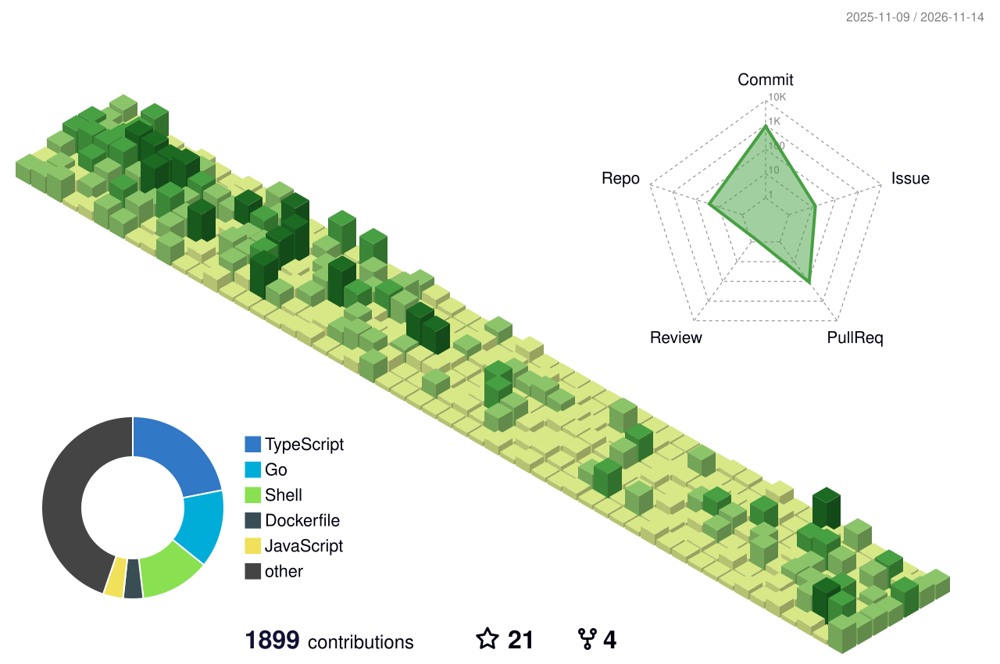

<div align="center">
  <a href="https://git.io/typing-svg">
    
  </a>

  <p>DevOps engineer and backend developer focused on automation, infrastructure, and open-source tooling.</p>

  <p>
    <a href="https://www.tteam.icu"></a>
    <a href="mailto:work@tteam.icu"></a>
    <a href="https://space.bilibili.com/11479221"></a>
    
  </p>
</div>

## About me

- Building reusable Go, React, FastAPI, and Vue templates at [ttutils](https://github.com/ttutils).
- Maintaining practical Dockerfile examples at [ttdockerfile](https://github.com/ttdockerfile).
- Working on infrastructure and delivery for [muen-docker-ops](https://github.com/muen-docker-ops).
- More than nine years of hands-on experience, and still learning every day.

## Tech stack

**Languages**

<p>
  
  
  
  
  
  
</p>

**Backend & Frontend**

<p>
  
  
  
  
  
  
  
</p>

**Infrastructure & Virtualization**

<p>
  
  
  
  
  
  
  
</p>

**Operating Systems**

<p>
  
  
  
  
  
</p>

## Coding activity

<!--START_SECTION:waka-->

```txt
From: 15 September 2023 - To: 26 November 2026

Total Time: 1,853 hrs 40 mins

Other                      322 hrs 9 mins        >>>>---------------------   17.38 %
Bash                       275 hrs 39 mins       >>>>---------------------   14.87 %
Python                     204 hrs 2 mins        >>>----------------------   11.01 %
TypeScript                 173 hrs 54 mins       >>-----------------------   09.38 %
Go                         159 hrs 52 mins       >>-----------------------   08.62 %
YAML                       121 hrs 13 mins       >>-----------------------   06.54 %
Markdown                   109 hrs 7 mins        >------------------------   05.89 %
JavaScript                 103 hrs 32 mins       >------------------------   05.59 %
JSON                       64 hrs 38 mins        >------------------------   03.49 %
Vue.js                     44 hrs 17 mins        >------------------------   02.39 %
```

<!--END_SECTION:waka-->

## GitHub activity

<p align="center">
  <picture>
    <source media="(prefers-color-scheme: dark)" srcset="https://github-readme-stats.vercel.app/api?username=buyfakett&amp;show_icons=true&amp;hide_border=true&amp;rank_icon=github&amp;theme=github_dark&amp;bg_color=00000000" />
    <source media="(prefers-color-scheme: light)" srcset="https://github-readme-stats.vercel.app/api?username=buyfakett&amp;show_icons=true&amp;hide_border=true&amp;rank_icon=github&amp;theme=default&amp;bg_color=00000000" />
    
  </picture>
  <picture>
    <source media="(prefers-color-scheme: dark)" srcset="https://github-readme-stats.vercel.app/api/top-langs/?username=buyfakett&amp;layout=compact&amp;langs_count=8&amp;hide_border=true&amp;theme=github_dark&amp;bg_color=00000000" />
    <source media="(prefers-color-scheme: light)" srcset="https://github-readme-stats.vercel.app/api/top-langs/?username=buyfakett&amp;layout=compact&amp;langs_count=8&amp;hide_border=true&amp;theme=default&amp;bg_color=00000000" />
    
  </picture>
</p>

<picture>
  <source media="(prefers-color-scheme: dark)" srcset="https://raw.githubusercontent.com/buyfakett/buyfakett/output/github-contribution-grid-snake-dark.svg" />
  <source media="(prefers-color-scheme: light)" srcset="https://raw.githubusercontent.com/buyfakett/buyfakett/output/github-contribution-grid-snake.svg" />
  
</picture>

<details>
  <summary><strong>3D contribution graph</strong></summary>
  <br />
  
</details>

## Recent blog posts

<!-- BLOG-POST-LIST:START -->
 - [2026-11-06 Debian的fstrim定时任务导致周一凌晨告警](https://www.tteam.icu/blog/ops/Debian%E7%9A%84fstrim%E5%AE%9A%E6%97%B6%E4%BB%BB%E5%8A%A1%E5%AF%BC%E8%87%B4%E5%91%A8%E4%B8%80%E5%87%8C%E6%99%A8%E5%91%8A%E8%AD%A6)
 - [2026-10-29 线上虚机断电后XFS文件系统损坏修复记录](https://www.tteam.icu/blog/ops/%E7%BA%BF%E4%B8%8A%E8%99%9A%E6%9C%BA%E6%96%AD%E7%94%B5%E5%90%8EXFS%E6%96%87%E4%BB%B6%E7%B3%BB%E7%BB%9F%E6%8D%9F%E5%9D%8F%E4%BF%AE%E5%A4%8D%E8%AE%B0%E5%BD%95)
 - [2026-09-20 从阿里云ECS自建MySQL迁移到阿里云RDS](https://www.tteam.icu/blog/ops/%E4%BB%8E%E9%98%BF%E9%87%8C%E4%BA%91ECS%E8%87%AA%E5%BB%BAMySQL%E8%BF%81%E7%A7%BB%E5%88%B0%E9%98%BF%E9%87%8C%E4%BA%91RDS)
 - [2026-07-25 2026年度优化主页](https://www.tteam.icu/blog/dev/2026%E5%B9%B4%E5%BA%A6%E4%BC%98%E5%8C%96)
 - [2026-04-05 mac终端改造](https://www.tteam.icu/blog/dev/mac%E7%BB%88%E7%AB%AF%E6%94%B9%E9%80%A0)
 - [2026-03-26 【vps测评】oracle](https://www.tteam.icu/blog/vps/%E3%80%90vps%E6%B5%8B%E8%AF%84%E3%80%91oracle)
 - [2026-03-22 我把我三个网站合在一起了](https://www.tteam.icu/blog/dev/%E6%88%91%E6%8A%8A%E6%88%91%E4%B8%89%E4%B8%AA%E7%BD%91%E7%AB%99%E5%90%88%E5%9C%A8%E4%B8%80%E8%B5%B7%E4%BA%86)
 - [2026-03-01 【vps测评】netcup](https://www.tteam.icu/blog/vps/%E3%80%90vps%E6%B5%8B%E8%AF%84%E3%80%91netcup)
 - [2026-03-01 我抽空写了3个rspress插件](https://www.tteam.icu/blog/dev/%E6%88%91%E6%8A%BD%E7%A9%BA%E5%86%99%E4%BA%863%E4%B8%AArspress%E6%8F%92%E4%BB%B6)
 - [2026-01-19 年度计划 2026](https://www.tteam.icu/blog/plans/year/Y2026)<!-- BLOG-POST-LIST:END -->
